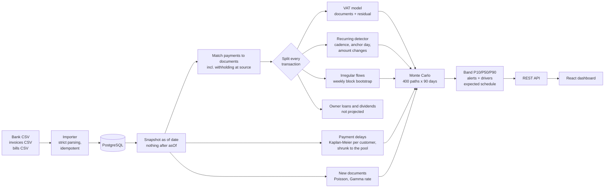

# runway

[](https://github.com/MoyalShoham/runway/actions/workflows/ci.yml)

Cash-flow forecasting for small businesses. Import bank transactions, open invoices and bills; runway
finds the recurring flows, learns how late each customer pays, and forecasts the daily balance 90
days ahead as a **range**, not a single line. It warns before the balance is likely to drop below
zero or below a minimum you set: when, how much cash would cover it, and which flows drive it.
"What if" scenarios (a customer pays 30 days late, a new hire, a one-off purchase) are shown against
the baseline.

Built for Israeli small businesses: shekels, VAT paid every two months at the rate in force on each
document (17% until 2024, 18% from 2025), withholding tax at source, payment terms like *shotef + 60*
(end of month + 60 days), Friday–Saturday weekends, Hebrew bank exports.

**Held-out result** (60 synthetic companies the model was never tuned on):
- **Warnings:** runway warned about **84%** of cash shortfalls below the user's minimum at the first
  chance, a median **42 days** ahead, and **23%** of its alerts were false alarms. A simple "less than
  one month of outflows left" rule caught about as many (81%), but **59%** of its alerts were false.
- **Balance error:** runway's 30-day error was **34% lower** than "balance stays flat". At 90 days it
  is 17% lower, and the 90-day band is too narrow.

Details, intervals and caveats are in [Results](#results).


## Why it is hard

- **Customers pay late, unevenly.** An invoice due today might arrive in a week or in two months.
  Learning delays from paid invoices alone is biased: the slowest payers are exactly the ones whose
  invoices are still open. runway uses survival analysis (Kaplan–Meier), so open invoices count as
  evidence too.
- **Payments don't match invoices.** Many Israeli customers withhold 2–30% at source and pay the
  rest, so a payment of ₪11,300 can settle an invoice of ₪11,800. Missing that link makes the same
  income show up twice.
- **Recurring flows drift.** Rent on the 1st lands on the 3rd when the 1st is a Saturday; salaries
  paid on the last day slip into the next month; a subscription changes price; a retainer ends.
- **VAT is a large, lumpy payment** every two months, and it depends on invoices that have not been
  issued yet.
- **A single line is a lie.** The useful answer is "probably between X and Y, with a 40% chance of
  dipping below your minimum by March". That needs calibrated uncertainty and an honest check that
  the range holds on data the model was not tuned on.

## How it works



Every bank transaction is assigned to exactly one component:

| Component | What it covers | Model |
|---|---|---|
| Open invoices and bills | Money already owed | Due date plus a payment delay drawn from that customer's Kaplan–Meier curve, conditioned on how overdue it already is |
| Recurring items | Rent, salaries, pension, subscriptions, retainers paid without invoices | Cadence (weekly to yearly) with tolerance for weekend shifts and skipped months; next amount from the last three |
| Future invoices and bills | Documents not issued yet | Recurring documents (retainers) per their pattern; ad-hoc ones as a seasonal Poisson process copying recent real documents |
| VAT | Bimonthly VAT payments | VAT on invoices minus VAT on bills in each period, at the rate in force on each document, including simulated future documents, plus a residual learned from past payments |
| Irregular flows | Card purchases, walk-in sales | Two-level weekly block bootstrap with month-of-year seasonality |
| Owner financing | Owner loans, dividends | Not projected: they are owner decisions |

A bank payment is linked to an invoice or bill when it is within three days of the recorded payment
date and is either the exact amount or, from the same counterparty, 70–100% of it (withholding at
source). Payments split across transfers, or one transfer settling several documents, are not
linked. Their transactions fall into the recurring or irregular flows, and can then be counted
alongside the document model (see [Limitations](#limitations-and-next-steps)).

Each of 400 paths samples all of these. Each item, down to each simulated new invoice, draws from
its own random stream, so a scenario changes only what it touches and the comparison with the
baseline is not noise. Alerts fire when at least half of the paths dip below a threshold. The alert
reports the date by which that happens and how much cash added today would bring the risk under 50%.

See [docs/decisions.md](docs/decisions.md) for what was chosen, what was rejected, and why.

## Run it

```bash
docker compose up --build
```

Open http://localhost:3000 and press **Load a demo company** (three years of synthetic history
ending today), or **New company** and upload the files in [`sample-data/`](sample-data/) (opening
date 2022-12-31, balance and minimum in `sample-data/company.txt`). Set `RUNWAY_PORT` if port 3000
is taken.

Development:

```bash
docker run -d --name runway-db -e POSTGRES_DB=runway -e POSTGRES_USER=runway -e POSTGRES_PASSWORD=runway -p 5432:5432 postgres:16-alpine
cd backend && ./mvnw spring-boot:run          # API on :8080, needs JDK 21
cd frontend && npm ci && npm run dev          # UI on :5173, proxies /api
```

Checks (the same as CI):

```bash
cd backend && ./mvnw verify                   # Spotless, javac -Xlint:all -Werror, 99 tests (Testcontainers needs Docker)
cd frontend && npm run format:check && npm run lint && npm run typecheck && npm test
```

### CSV formats

| File | Columns |
|---|---|
| Transactions | `date`, `amount` (or `debit` + `credit`), `description`, `counterparty`. Hebrew headers work (תאריך, תאריך ערך, סכום, חובה, זכות, תיאור); with both a booking and a value date, the booking date is used. |
| Invoices / bills | `number`, `customer`/`vendor`, `issue_date`, `due_date`, `amount` (with VAT), `paid_date` (empty if open) |

- **Dates:** ISO (`2025-03-01`) or day-first (`01/03/2025`, `01/03/25`).
- **Amounts:** up to 13 digits with two decimals. They may use thousands separators, `₪`,
  parentheses or a trailing minus.
- **Debit and credit:** a `0` in the unused column is fine.
- **Encoding:** UTF-8, Windows-1255, or UTF-16 with a byte-order mark.
- **Invalid rows:** by default, a file with any invalid row is rejected whole, with every bad line
  listed.
- **Re-importing:** the same bank file adds nothing. Re-importing documents updates them (for
  example, it records a payment).
- **Per-company limits:** 200,000 transactions and 20,000 invoices and bills.

### API

State-changing requests (`POST`, `PATCH`, `DELETE`) must send an `X-Runway-Client` header, any
value; it protects against cross-site request forgery.

| Method | Path | |
|---|---|---|
| `POST` | `/api/companies` | Create (`name`, `openingBalance`, `openingDate`, `minimumBalance`) |
| `POST` | `/api/companies/{id}/transactions/import` | Multipart `file`; `?skipInvalid=true` imports the valid rows |
| `POST` | `/api/companies/{id}/invoices/import`, `/bills/import` | Same |
| `GET` | `/api/companies/{id}/forecast?asOf=&horizonDays=` | Band, alerts, schedule, recurring items, customer names |
| `POST` | `/api/companies/{id}/scenarios` | `{"scenarios":[{"type":"CUSTOMER_PAYS_LATE","customer":"<a name from customers>","extraDays":30}]}` |
| `GET` | `/api/companies/{id}/history?days=120` | Actual daily balances |
| `POST` | `/api/demo?seed=7` | Generate a demo company (at most one every 3 seconds) |

- **Money:** a decimal string in JSON (`"1234.50"`), `NUMERIC(16,2)` in the database and
  `BigDecimal` in Java.
- **Errors:** RFC 7807 problem details. An unknown customer or a scenario date more than a year from
  the data is a 400.
- **Load:** at most a few simulations run at once; beyond that, requests wait briefly and then get a
  503.

## Results

### Data

There is no public dataset of small-business bank accounts, so
[`CompanyGenerator`](backend/src/main/java/io/github/moyalshoham/runway/sim/CompanyGenerator.java)
simulates Israeli businesses of four kinds: consultancy, agency, café (`RETAIL` in the result
files) and contractor. The generator is deliberately richer than the model. Each company has three
years of history in ILS, with:

- **VAT** paid bimonthly at 17% until 2024 and 18% from 2025.
- **Customers** with hidden payment habits, from early to chronically late with occasional defaults,
  on terms up to end of month + 90. About a third of business customers withhold tax at source.
- **Payroll** on the 9th, with pension, national insurance and withholding on the 15th.
- **Utilities and tax:** bimonthly electricity and arnona bills, VAT refunds and income-tax
  advances.
- **Seasonality and change:** holidays (Tishrei, Pesach, August), staff turnover and January raises.
- **Owner behaviour:** owners lend money when the overdraft gets deep and take dividends when cash
  piles up.

### Method

The backtest is walk-forward:

1. From each cutoff, every 14 days from July 2024, the engine sees only what was known that day.
   No look-ahead leakage was found in an independent review that scrambled all post-cutoff data and
   got identical forecasts.
2. It forecasts 90 days ahead.
3. The forecast is compared with what happened.

Settings (dispersion 1.6, alert probability 0.5) were tuned on **dev** companies (seeds 1–24). The
reported numbers are from **holdout** companies (seeds 1001–1060).

**The holdout split was run twice, with the same settings.** The first run was at commit `8d4267a`.
An independent code review then found real bugs: payments net of withholding were counted twice; a
customer whose invoices were all still open was assumed to pay on time; one random-number issue let
"lose a customer" raise cash on some paths. It also found gaps in the generator's realism: VAT was
18% in 2023–2024, and there was no withholding. After fixing these, holdout was re-run at `34a8192`.
Nothing was tuned on holdout either time. The first run, kept in the git history of `eval/`,
reported a 31% lower 30-day error than "flat", 11% lower at 90 days, 85% cutoff-level recall and a
31% false-alarm share. After the fixes, recall is unchanged; the errors and the false-alarm share
are lower.

To reproduce, run this from `backend/`. It writes to `backend/target/eval` and takes about 30 s:

```bash
./mvnw -q compile exec:java -Dexec.args="--split holdout"
```

Full output: [eval/results-holdout.md](eval/results-holdout.md); dev:
[eval/results-dev.md](eval/results-dev.md). Intervals are 95%, from resampling companies (1,000
rounds).

### Balance error

Mean absolute error of the median forecast against the actual balance (1,980 forecasts):

| Horizon | runway | Balance stays flat | Last 30 days repeated | runway vs flat | 10–90% band coverage (target 80%) |
|---|---:|---:|---:|---:|---:|
| 7 days | ₪32,031 | ₪62,100 | ₪73,554 | −48% | 88% |
| 30 days | ₪62,105 | ₪94,059 | ₪147,774 | −34% (−30% to −38%) | 82% |
| 90 days | ₪120,245 | ₪144,790 | ₪348,661 | −17% (−9% to −24%) | 72% (66% to 77%) |

Part of the 90-day error is owner loans and dividends taken after the cutoff, which react to the
cash position and cannot be forecast. Measured against the balance without them, runway's 90-day
error is ₪73,235 against ₪145,714 for flat (−50%). In that view the band covers 90%, so it is too
wide there and too narrow on the raw balance. One dispersion factor can't fit both.

### Shortfall warnings

A shortfall event is a company's balance falling below the threshold. It counts if the balance was
above the threshold at a cutoff and fell below it 7 to 90 days later, leaving at least a week to act.
The same event is usually visible from several cutoffs. "First chance" means the earliest of those
cutoffs.

Below the user's minimum (113 events in 60 companies):

| Method | Warned at the first chance | Warned at some cutoff | Median lead of first warning | False-alarm share of alerts |
|---|---:|---:|---:|---:|
| **runway** | **84%** (78% to 89%) | 96% | 42 days | **23%** (15% to 33%) |
| Cushion rule: less than one month of outflows above the minimum | 81% | 99% | 48 days | 59% |
| Last 30 days repeated | 55% | 88% | 35 days | 51% |

Below zero (76 events): runway warned 75% at the first chance and 100% at some cutoff, with 26% false
alarms; the cushion rule 70% / 97%, with 62% false alarms. "Balance stays flat" never warns, by
construction.

The honest reading: a crude cushion rule already catches most shortfalls. What runway adds is
precision: about a quarter of its alerts are false alarms, against about 60% for the rule. It also
adds the date, the amount, and the flows behind each alert.

## Limitations and next steps

- **Synthetic data only.** The generator and the model were written by the same person; even with
  the generator deliberately richer than the model, real bank data will be messier and the numbers
  above are an upper bound. The next step is a backtest on real, anonymised exports.
- **The band is miscalibrated at 90 days:** 72% coverage on holdout against 80%, and 90% when owner
  financing is excluded. A horizon-dependent factor, fit on dev only, is the obvious next step.
- **About a quarter of alerts are false alarms.** The alert threshold was chosen on dev to favour
  recall (F2 score). A product would let the user trade recall for fewer alerts.
- **Owner financing is not predicted.** At 90 days runway is 17% better than "flat" on raw
  balances, and much of the gap is owner loans and dividends. They are recognised by a counterparty
  pattern whose defaults match common Hebrew and English labels (and the generator's). Real users
  would need to tag these flows.
- **Some payments are not linked to their documents.** One transfer paying several invoices, or one
  invoice paid in parts, falls into recurring or irregular flows and can be counted twice.
- **No public holidays** in the business calendar, only the Friday–Saturday weekend. The calendar
  could come from Hebcal.
- **VAT refunds are not forecast.** Monthly VAT reporters need the period changed in settings (the
  API does not expose it yet).
- **No feedback loop.** Real owners delay bills when cash is tight; the model assumes they don't.
- **New recurring items need history.** An item is projected as recurring after three occurrences
  (four for weekly and biweekly, two for yearly). Until then it is part of the irregular flows.
- **No authentication and a single tenant.** The UI is bound to localhost. nginx drops requests for
  other host names, and writes need a custom header. Anything beyond a local tool needs
  authentication and per-user data isolation.
- **Manual import.** There is no bank API or open-banking connection.

## Project layout

```
backend/   Spring Boot 3.5, Java 21
  engine/      forecasting engine, plain Java (ArchUnit-enforced: no Spring, no DB)
  sim/         synthetic company generator, CSV export
  backtest/    walk-forward backtest, baselines, bootstrap intervals, CLI
  importer/    CSV parsing and validation
  api/ service/ persistence/   REST, services, JdbcClient repositories, Flyway migrations
frontend/  React 19 + TypeScript (strict), Vite, Recharts
eval/      backtest results (dev and holdout)
docs/      design decisions
```
