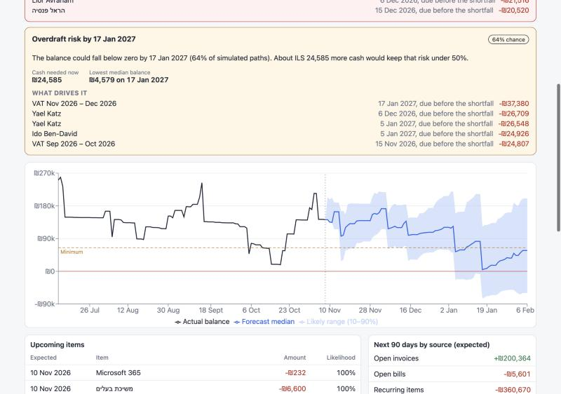
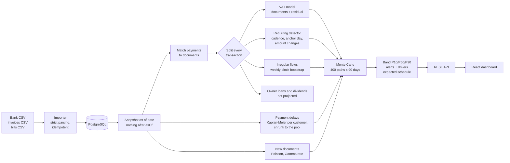

# runway

[](https://github.com/MoyalShoham/runway/actions/workflows/ci.yml)

Cash-flow forecasting for small businesses. Import bank transactions, open invoices and bills; runway
finds the recurring flows, learns how late each customer pays, and forecasts the daily balance 90
days ahead as a **range**, not a single line. It warns before the balance is likely to drop below
zero or below a minimum you set: when, how much cash would cover it, and which flows drive it.
"What if" scenarios (a customer pays 30 days late, a new hire, a one-off purchase) are shown against
the baseline.

Built for Israeli small businesses: shekels, 18% VAT paid every two months, payment terms like
*shotef + 60* (end of month + 60 days), Friday–Saturday weekends, Hebrew bank exports.

**Held-out result (60 synthetic companies, 1,980 forecasts):** runway warned about **85%** of real
shortfalls below the user's minimum, a median **35 days** ahead, against 50% for a "last 30 days
repeated" baseline. Its 30-day balance error was **31% lower** than "balance stays flat". At 90 days
it is only 11% better, and the band is too narrow there. Details and caveats are in [Results](#results).



## Why it is hard

- **Customers pay late, unevenly.** An invoice due today might arrive in a week or in two months.
  Learning delays from paid invoices alone is biased: the slowest payers are exactly the ones whose
  invoices are still open. runway uses survival analysis (Kaplan–Meier), so open invoices count as
  evidence too.
- **Recurring flows drift.** Rent on the 1st lands on the 3rd when the 1st is a Saturday; salaries
  paid on the last day slip into the next month; a subscription changes price; a retainer ends.
- **VAT is a large, lumpy payment** every two months, and it depends on invoices that have not been
  issued yet.
- **A single line is a lie.** The useful answer is "probably between X and Y, with a 40% chance of
  dipping below your minimum by March". That needs calibrated uncertainty and an honest check that
  the range holds on data the model was not tuned on.

## How it works



Every bank transaction is explained by exactly one component, so nothing is counted twice:

| Component | What it covers | Model |
|---|---|---|
| Open invoices and bills | Money already owed | Due date plus a payment delay drawn from that customer's Kaplan–Meier curve, conditioned on how overdue it already is |
| Recurring items | Rent, salaries, pension, subscriptions, retainers paid without invoices | Cadence (weekly to yearly) with tolerance for weekend shifts and skipped months; next amount from the last three |
| Future invoices and bills | Documents not issued yet | Recurring documents (retainers) per their pattern; ad-hoc ones as a seasonal Poisson process copying recent real documents |
| VAT | Bimonthly VAT payments | VAT on invoices minus VAT on bills in each period, including simulated future documents, plus a residual learned from past payments |
| Irregular flows | Card purchases, walk-in sales | Two-level weekly block bootstrap with month-of-year seasonality |
| Owner financing | Owner loans, dividends | Not projected: they are owner decisions |

Each of 400 paths samples all of these. Each item draws from its own random stream, so a scenario
changes only what it touches and the comparison with the baseline is not noise. Alerts fire when at
least half of the paths dip below a threshold. The alert reports the date by which that happens and
how much cash added today would bring the risk under 50%.

See [docs/decisions.md](docs/decisions.md) for what was chosen, what was rejected, and why.

## Run it

```bash
docker compose up --build
```

Open http://localhost:3000 and press **Load a demo company** (three years of synthetic history
ending today), or create a company and upload the files in [`sample-data/`](sample-data/). Set
`RUNWAY_PORT` if port 3000 is taken.

Development:

```bash
docker run -d --name runway-db -e POSTGRES_DB=runway -e POSTGRES_USER=runway -e POSTGRES_PASSWORD=runway -p 5432:5432 postgres:16-alpine
cd backend && ./mvnw spring-boot:run          # API on :8080, needs JDK 21
cd frontend && npm ci && npm run dev          # UI on :5173, proxies /api
```

Checks (the same as CI):

```bash
cd backend && ./mvnw verify                   # Spotless, javac -Xlint:all -Werror, 78 tests (Testcontainers needs Docker)
cd frontend && npm run format:check && npm run lint && npm run typecheck && npm test
```

### CSV formats

| File | Columns |
|---|---|
| Transactions | `date`, `amount` (or `debit` + `credit`), `description`, `counterparty`. Hebrew headers (תאריך, סכום, חובה, זכות, תיאור) work. |
| Invoices / bills | `number`, `customer`/`vendor`, `issue_date`, `due_date`, `amount` (with VAT), `paid_date` (empty if open) |

Dates are ISO (`2025-03-01`) or day-first (`01/03/2025`). Amounts may use thousands separators,
`₪`, parentheses or a trailing minus. Files can be UTF-8 or Windows-1255. By default a file with any
invalid row is rejected whole, with every bad line listed. Re-importing the same bank file adds
nothing, and re-importing documents updates them (e.g. records a payment).

### API

| Method | Path | |
|---|---|---|
| `POST` | `/api/companies` | Create (`name`, `openingBalance`, `openingDate`, `minimumBalance`) |
| `POST` | `/api/companies/{id}/transactions/import` | Multipart `file`; `?skipInvalid=true` imports the valid rows |
| `POST` | `/api/companies/{id}/invoices/import`, `/bills/import` | Same |
| `GET` | `/api/companies/{id}/forecast?asOf=&horizonDays=` | Band, alerts, schedule, recurring items |
| `POST` | `/api/companies/{id}/scenarios` | `{"scenarios":[{"type":"CUSTOMER_PAYS_LATE","customer":"Acme","extraDays":30}]}` |
| `GET` | `/api/companies/{id}/history?days=120` | Actual daily balances |
| `POST` | `/api/demo?seed=7` | Generate a demo company |

Money is a decimal string in JSON (`"1234.50"`), `NUMERIC(16,2)` in the database and `BigDecimal`
in Java. Errors are RFC 7807 problem details.

## Results

**Data.** There is no public dataset of small-business bank accounts, so
[`CompanyGenerator`](backend/src/main/java/io/github/moyalshoham/runway/sim/CompanyGenerator.java)
simulates Israeli businesses of four kinds: consultancy, agency, café, contractor. Each has three
years of history in ILS with 18% VAT paid bimonthly. Customers have hidden payment habits (from
early to chronically late, with occasional defaults) on terms up to end of month + 90. Payroll is
paid on the 9th, with pension, national insurance and withholding on the 15th. There are bimonthly
electricity and arnona bills, holiday seasonality (Tishrei, Pesach, August), staff turnover, January
raises, VAT refunds and income-tax advances. Owners lend money when the overdraft gets deep and take
dividends when cash piles up. The generator is deliberately richer than the model.

**Method.** Walk-forward backtest. From each cutoff, every 14 days from July 2024, the engine sees
only what was known that day and forecasts 90 days ahead; the forecast is then compared with what
happened. Model settings (dispersion 1.6, alert probability 0.5) were tuned on **dev** companies
(seeds 1–24). The numbers below are from **holdout** companies (seeds 1001–1060), run once, at
commit `8d4267a`, after the settings were frozen. Reproduce with
`./mvnw -q exec:java -Dexec.args="--split holdout"` (about 30 s). Full output:
[eval/results-holdout.md](eval/results-holdout.md); dev: [eval/results-dev.md](eval/results-dev.md).

**Balance error**, mean absolute error of the median forecast against the actual balance:

| Horizon | runway | Balance stays flat | Last 30 days repeated | runway vs flat | 10–90% band coverage (target 80%) |
|---|---:|---:|---:|---:|---:|
| 7 days | ₪34,346 | ₪64,494 | ₪77,088 | −47% | 87% |
| 30 days | ₪66,929 | ₪96,747 | ₪154,391 | −31% | 81% |
| 90 days | ₪129,075 | ₪145,476 | ₪366,044 | −11% | 71% |

Part of the 90-day error is owner loans and dividends taken after the cutoff, which react to the
cash position and cannot be forecast. Measured against the balance without them (business-as-usual
error), runway's 90-day error is ₪75,873 against ₪147,290 for flat (−48%), and the band covers 90%.

**Shortfall warnings.** A real shortfall is a cutoff where the balance was above the threshold and
then actually fell below it 7 to 90 days later, leaving at least a week to act:

| Threshold | Real shortfalls | runway warned | runway false-alarm share | Last 30 days repeated: warned | False-alarm share |
|---|---:|---:|---:|---:|---:|
| User's minimum | 296 | **85%** (251) | 31% (142 of 453 alerts) | 50% | 60% |
| Zero | 213 | **88%** (187) | 31% (96 of 313 alerts) | 53% | 67% |

Median warning lead time: 35 days (minimum), 41 days (zero). "Balance stays flat" never warns, by
construction.

## Limitations and next steps

- **Synthetic data only.** The generator and the model were written by the same person; even with
  the generator deliberately richer than the model, real bank data will be messier and the numbers
  above are an upper bound. The next step is a backtest on real, anonymised exports.
- **The 90-day band is too narrow on holdout** (71% coverage against 80%). The dispersion factor was
  fit on dev, where 90-day coverage was 78%, and did not fully transfer. A horizon-dependent factor
  is the obvious fix, but it has to be fit on dev only.
- **About a third of alerts are false alarms.** The alert threshold was chosen on dev to favour
  recall (F2 score). A product would let the user trade recall for fewer alerts.
- **At 90 days runway is only 11% better than "flat"** on raw balances. Most of the gap is owner
  financing, which runway does not try to predict. Owner loans and dividends are recognised by a
  counterparty pattern whose default matches common Hebrew and English labels (and the generator's).
  Real users would need to tag these flows.
- **Payment matching is one-to-one.** Partial payments and one transfer settling several invoices
  are not matched, so they fall into irregular flows. Full reconciliation is a separate project.
- **No public holidays** in the business calendar, only the Friday–Saturday weekend. The calendar
  could come from Hebcal.
- **VAT refunds are not forecast**, and monthly VAT reporters need the period changed in settings
  (the API does not expose it yet).
- **No feedback loop.** Real owners delay bills when cash is tight; the model assumes they don't.
- **A new recurring item needs three occurrences** (two for yearly) before it is projected as
  recurring. Until then it is part of the irregular flows.
- **No authentication and a single tenant.** The UI is bound to localhost in Docker Compose; anything
  beyond a local tool needs authentication and per-user data isolation.
- **Manual import.** There is no bank API or open-banking connection.

## Project layout

```
backend/   Spring Boot 3.5, Java 21
  engine/      forecasting engine, plain Java (ArchUnit-enforced: no Spring, no DB)
  sim/         synthetic company generator, CSV export
  backtest/    walk-forward backtest, baselines, CLI
  importer/    CSV parsing and validation
  api/ service/ persistence/   REST, services, JdbcClient repositories, Flyway migrations
frontend/  React 19 + TypeScript (strict), Vite, Recharts
eval/      backtest results (dev and holdout)
docs/      design decisions
```
